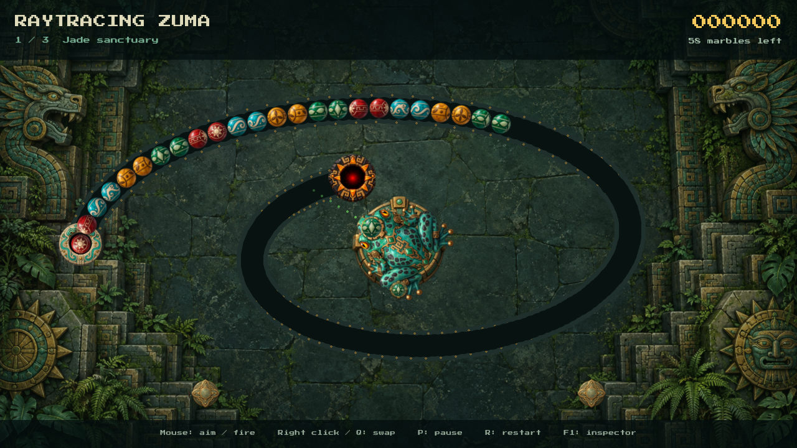

# Raytracing Zuma

A Zuma-style marble shooter built with the same **C# / .NET 8, Radiant, and MonoGame 3.8.6 DesktopVK** stack as the sibling Pac-Man demo. Uses Radiant's 2D HRC global illumination, color management, and UDR4 temporal upscaling at Balanced quality.



Aim the jade frog and fire into the moving chain. Match at least three marbles of the same color to clear them. Joined groups can trigger chain reactions and multiply your score. Clear every marble before the chain reaches the glowing temple exit.

- Three spiral temples with increasing speed and marble counts.
- Original generated jade-and-bronze frog guardian, painted temple courtyard, and carved temple props.
- Four marble designs with eight rolling frames each, emissive stone channels, and match particles.
- Loaded and next marble previews, ammo swapping, score, and danger warning.
- Pause, restart, level progression, and the Radiant inspector.
- Proportional board fitting and mouse mapping across window sizes.

## Play

Requires the sibling `radiant-game-engine` checkout and Vulkan graphics drivers:

```sh
dotnet run -c Release --project raytracing-zuma.csproj
```

| Control | Action |
| --- | --- |
| Mouse | Aim |
| Left click / hold | Fire |
| Right click / Q | Swap loaded and next marble |
| P / Space | Pause / resume |
| R | Restart current temple and reset score |
| Enter after a round | Advance after winning, retry after losing |
| F1 | Radiant inspector, lighting and UDR quality settings |
| Esc | Exit |

The game uses Radiant's existing 2D lighting technology; it does not add a separate hardware 3D ray tracer. The character, marble sprites, courtyard, and temple props were newly generated from text descriptions using the built-in image generation tool, without original-game artwork or visual references. See [art sources and prompts](Content/art/README.md).

See [BUILD.md](BUILD.md) for source setup, tests, isolated graphics checks, and publishing.
